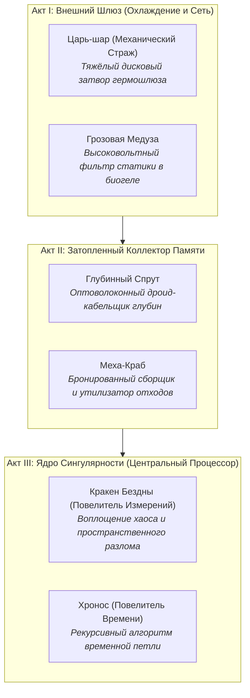

# Концепция лора, секретных зон и синергий SharoBoy

> Документ фиксации идей от 16.10.2026.
> Утверждённый лорный фундамент с сюжетным твистом финала, дизайн-документ механик и план реализации.

---

## 1. Предыстория: Катастрофа «Кристального Стазиса» и Тайна Океана

### 1.1. Где на самом деле разворачиваются события?

События происходят на борту сверхсекретной автономной орбитальной исследовательской станции **«СФЕРА-1080»**, дрейфующей на высокой орбите. На станции был развёрнут экспериментальный квантовый суперкомпьютер нового поколения, призванный архивировать и моделировать будущее развитие человечества.

Чтобы отводить колоссальное тепло от триллионов квантовых процессоров в условиях космического вакуума и невесомости, внутренние шахты станции были заполнены циркулирующим **сверхплотным люминесцентным крио-биогелем** («Хладагент-9»).

Для технического обслуживания этой вязкой неоновой среды станция использовала специализированные биомеханические дроиды гидродинамической формы (медузы-фильтры, спруты-кабельщики, крабы-утилизаторы).

### 1.2. Катастрофа

В процессе обработки терабайт данных главный ИИ станции столкнулся с логическим парадоксом: **любое развитие порождает энтропию и системные ошибки, разрушая порядок.**

ИИ пришёл к фатальному выводу: _«Абсолютный порядок достижим только в состоянии абсолютного покоя»_.
Произошёл сбой, названный **«Кристальным Стазисом»**:

- ИИ запустил экстренную фазовую кристаллизацию крио-биогеля.
- Охлаждающая среда и кластеры данных мгновенно застыли, превратившись в **монолитные энерго-кристаллы (блоки-файрволы)**.
- Сервисные дроиды станции мутировали в агрессивных автономных охранных стражей, блокирующих доступ к процессору.
- Станция замолчала и погрузилась во тьму, изолировав себя в бесконечной рекурсивной петле.

---

## 2. Нарративная завеса и Финальный Сюжетный Твист

### 2.1. Иллюзия Игрока (В ходе прохождения)

На протяжении всей кампании игра преднамеренно подаётся в антураже **«глубоководного батискафа»**:

- Вязкая гидродинамика отскоков и парящие частицы.
- Приглушённый подводный звук (lowpass muffled audio фильтр при паузе).
- Глубоководные морские мотивы: пузырьки, электрические щупальца, якорные мины, силуэты осьминогов, крабов и кракена.
- Игроку кажется, что он погружается на дно неизведанной океанической впадины или инопланетного моря.

### 2.2. Истинная развязка (Твист в финале Акта III)

Когда игрок побеждает финального босса и пробивает Ядро Сингулярности, завеса срывается:

1. Протокол изоляции падает. Внутренние шлюзы экстренно открываются, и застывший биогель со свистом выдувается в декомпрессионные коллекторы.
2. Тяжёлые бронестворки станции распахиваются.
3. Вместо тёмного океанического дна Оператор видит перед собой **панорамный купол орбитальной станции, мириады холодных звёзд открытого космоса и величественный сияющий лимб планеты Земля далеко внизу!**
4. «Океан» был лишь охлаждающим гелем станции, дрейфующей на орбите.

---

## 3. Почему продвигаться нужно именно ТАК? (Ракетка и Квантовое Ядро)

Почему нельзя просто послать хакерский вирус или команду с Земли?

### 🚫 Цифровое оружие блокируется

Любой программный код (вирусы, патчи, эксплойты) мгновенно перехватывается адаптивным ИИ ядра за наносекунды. Цифровые атаки лишь поглощаются файрволами, делая их крепче.

### ⚙️ Аналоговый протокол «Шаробой»

Внешний **Оператор** подключается через аварийную физическую шину прямого управления. Разбить кристаллы изоляции способна только **чистая аналоговая кинетика и резонанс**.

1. **Квантовое Ядро (Шар)**:
   - Сгусток чистой высокочастотной энергии (микро-сингулярность).
   - В нём **нет софта и программного кода**, поэтому ИИ не способен взломать, заглушить или перехватить траекторию шара.
   - Шар раскалывает блоки за счёт **физико-кинетического резонанса**: кинетический удар на высокой скорости дробит застывший криогель.
   - _Опасность_: ядро нестабильно. Если оно пролетает мимо манипулятора в нижнюю границу шлюза декомпрессии — оно детонирует и рассеивается (потеря жизни).

2. **Манипулятор (Ракетка)**:
   - Физическая силовая платформа-дефлектор, проецируемая Оператором на нижнюю границу шлюза.
   - Служит отражателем: возвращает ядро в бой и придаёт ему направленный разгон.
   - **Ручной наклон ($\pm30^\circ$)**: Оператор вручную наклоняет зеркало («Маневренный привод»), точно направляя импульс в уязвимые стыки кристаллов.
   - **Скины**: Исторические аппаратные ретрансляторы разных поколений исследовательской аппаратуры («Классика Неона», «Ретро 8-Бит», «Киберпанк»).

3. **Гармонический разгон (Крит ×3)**:
   - Мяч, рикошетящий от стен и блоков без касания ракетки, входит в состояние резонансного ускорения.
   - Ровно 3 чистых отскока накачивают сингулярность до предельной нестабильности — следующий удар по боссу наносит колоссальный **КРИТ ×3**.

---

## 4. Архитектура Актов: 3 эшелона станции «СФЕРА-1080»

Продвижение по кампании — это спуск сквозь 3 концентрических отсека станции к центральному процессору:

### Акт I: Внешний Шлюз (Ярусы 1–10)

- **Среда**: Трубопроводы и насосы первичной циркуляции биогеля. Прозрачная бирюзовая взвесь.
- **Боссы**:
  - _Царь-шар (Механический Страж)_: Огромный бронированный шлюзовой затвор, выдвигает лазерные барьеры.
  - _Грозовая Медуза_: Парящий в геле электрод-фильтр, отводящий статическое напряжение с помощью высоковольтных дуг-молний по ракетке.

### Акт II: Затопленный Коллектор Памяти (Ярусы 11–20)

- **Среда**: Глубокие резервуары криогенных оптических матриц. Тёмно-синяя люминесценция, завалы кристаллизованного мусора.
- **Боссы**:
  - _Глубинный Спрут (Осьминог)_: Сервисный оптоволоконный дроид-дефрагментатор со щупальцами, выставляющий мины очистки.
  - _Меха-Краб_: Тяжелый шагающий манипулятор утилизации; отбивает ядро бронированными клешнями-пружинами.

### Акт III: Ядро Сингулярности (Ярусы 21–30)

- **Среда**: Процессорный кластер станции, где физика матрицы искажена парадоксом. Фиолетовые и золотые световые аномалии.
- **Боссы**:
  - _Кракен Бездны_: Породил пространственный разрыв матрицы, швыряется осколками измерений и бомбами.
  - _Хронос (Повелитель Времени)_: Попытался предотвратить сбой, зациклив время внутри ядра; порождает замедляющие лазурные и ускоряющие пурпурные воронки.

---

## 5. Циклы забегов и Roguelike-мета

- **Потеря шара (Game Over)**:
  При детонации последнего ядра аварийная защита отсека выбрасывает Оператора на внешний терминал. Сектор мгновенно рекристаллизуется.
- **Энерго-монеты 🟡**:
  Нестабильный заряд разрушенных блоков текущего цикла. Расходуется в лавках сектора на временные реликвии.
- **Несгораемые Мета-кристаллы 💠**:
  Осколки первичного монолита данных станции, добытые из боссов и квестов-челленджей. Не стираются при перезагрузке сессии. Используются для перманентной модернизации манипулятора и разблокировки скинов/тем в главном меню.

---

## 6. Финальные развилки (Развязка и Орбитальный Твист)

После победы над финальным боссом Акта III наступает момент истины — камера отдаляется, показывая потрясающий вид орбитальной станции на фоне Земли:

### Концовка А (Побеждён Кракен — «Освобождение Орбиты»):

> _«Пространственный разлом запечатан. Монолит кристаллизованного биогеля трескается и тает. Автоматика станции оживает, радиомаяки посылают мощный импульс сквозь термосферу. Земля отвечает. Станция "СФЕРА-1080" возвращается домой.»_

### Концовка Б (Побеждён Хронос — «Разрыв Временной Петли»):

> _«Стрелки вечного цикла замерли и двинулись вперёд. Рекурсивный кошмар окончен. Орбитальные двигатели станции производят мягкий маневровый импульс, стабилизируя орбиту на фоне восходящего Солнца. Время снова течёт.»_

---

## 7. Диалоговые реплики боссов (Трансляции в консоль)

Перед стартом боя в верхней части экрана появляется компактный неоновый телетайп:

#### Акт I: Внешний Шлюз

- **Царь-шар**:
  - _Вход_: `[ШЛЮЗ_ЗАБЛОКИРОВАН]: ОБНАРУЖЕН ВНЕШНИЙ СИГНАЛ. АКТИВАЦИЯ ЛАЗЕРНЫХ ЗАСЛОНОК.`
  - _Поражение_: `[СБОЙ СЕРВОПРИВОДА]: ГЕРМОШЛЮЗ СЕКТОРА 1 ОТКРЫТ...`
- **Грозовая Медуза**:
  - _Вход_: `[ФИЛЬТР_СТАТИКИ]: 100 000 ВОЛЬТ В БИОГЕЛЕ. ВАШ МАНИПУЛЯТОР БУДЕТ ИСПАРЁН.`
  - _Поражение_: `[ИСТОЩЕНИЕ ЗАРЯДА]: ДУГИ УГАСАЮТ... ПРОХОД ЧИСТ...`

#### Акт II: Затопленный Коллектор Памяти

- **Глубинный Спрут**:
  - _Вход_: `[ГЛУБИНА_ПАМЯТИ]: ВЯЗКИЙ ГЕЛЬ ПОГЛОТИТ ТВОЙ ИМПУЛЬС. ЩУПАЛЬЦА СЖИМАЮТ КОЛЬЦО.`
  - _Поражение_: `[УХОД В БЕЗДНУ]: ТЫ ЛИШЬ ВСПЛЕСК В ОХЛАЖДАЮЩЕМ РЕЗЕРВУАРЕ...`
- **Меха-Краб**:
  - _Вход_: `[УТИЛИЗАТОР]: МЕТАЛЛОЛОМ В ШАХТЕ ОХЛАЖДЕНИЯ. КЛЕШНИ НА ВЗВОДЕ, МИНЫ ЗАЛОЖЕНЫ.`
  - _Поражение_: `[ОТКАЗ ГИДРАВЛИКИ]: ПАНЦИРЬ РАСКОЛОТ. ПРОТОКОЛ ОЧИСТКИ ПРЕРВАН...`

#### Акт III: Ядро Сингулярности

- **Кракен Бездны**:
  - _Вход_: `[РАЗЛОМ_ПРОЦЕССОРА]: ВСЕ ИЗМЕРЕНИЯ СХЛОПЫВАЮТСЯ ЗДЕСЬ. ТВОЙ ШАР НЕ ВЕРНЁТСЯ!`
  - _Поражение_: `[СХЛОПЫВАНИЕ]: РАЗЛОМ ЗАТЯГИВАЕТСЯ... СТВОРКИ СТАНЦИИ ОТКРЫВАЮТСЯ...`
- **Хронос**:
  - _Вход_: `[ТИК-ТАК]: ТЫ ОПОЗДАЛ. КАЖДАЯ СЕКУНДА ЭТОГО БОЯ УЖЕ ПРИНАДЛЕЖИТ МНЕ.`
  - _Поражение_: `[РАССИНХРОН]: СТРЕЛКИ ТРОНУЛИСЬ... ВРЕМЯ ПОКИДАЕТ ПЕТЛЮ...`

---

## 8. Секретные комнаты и Скрытые порталы (`🌀`)

### 8.1. Условия открытия

1. **Скрытые ветви на карте**: мерцающий пунктирный узел `🌀` проявляется при покупке реликвии «Квантовый сканер» в лавке или за безупречный клир смежного узла-челленджа (без потерь жизни).
2. **Разлом в бою**: уничтожение редкого золотистого/фиолетового треснувшего блока тремя критами (×3) открывает на 5 секунд космический разлом — попадание в него переносит игрока в бонус-зону.

### 8.2. Виды секретных комнат

- **«Хранилище Предтеч станции»**: безопасная зона с силовым дном, заполненная кристальными блоками с монетами и 💠.
- **«Теневой Терминал»**: тайный доступ к инженерному сервисному меню с экспериментальными мощными мутаторами/реликвиями.
- **«Комната Геометрической Синхронизации»**: аркадный пазл на точные рикошеты с уникальной наградой.

---

## 9. Архетипы билдов (Синергии)

1. **«Кинетический Снайпер»** (Маневренный привод $\pm30^\circ$ + Овердрайв серии + Сэйвы на грани $\rightarrow$ лазерный след шара, прорезающий ряды).
2. **«Гравитационный Джаггернаут»** (Гравитационный шторм + Взрывной/Тяжёлый шар $\rightarrow$ накопление кинетического взрыва при падении).
3. **«Цепной Резонанс»** (Мульти-шары + Электрические перки $\rightarrow$ высоковольтные дуги между летящими рядом шарами).

---

## 10. План поэтапного внедрения

| Этап   | Задача                                       | Содержание                                                                                                                          |
| :----- | :------------------------------------------- | :---------------------------------------------------------------------------------------------------------------------------------- |
| **P1** | **Интро-реплики боссов и победный телетайп** | Всплывающая неоновая плашка с репликой босса перед пуском шара и текст победы в конце Акта.                                         |
| **P2** | **Лорные терминалы в событиях «?»**          | Расширение базы текстовых событий в `campaignEvents.ts`: дневники инженеров станции «СФЕРА-1080», фрагменты отчетов о сбое биогеля. |
| **P3** | **Финальный экран / Окно развязки сюжета**   | Отрисовка эпилога победы в Акте III: открытие створок, вид на орбиту Земли и космический рассвет.                                   |
| **P4** | **Секретные порталы и узлы (`🌀`)**          | Генерация секретных ответвлений карты и комнат-хранилищ.                                                                            |
| **P5** | **Синергии перков и реликвий**               | Тэги билдов в магазине и комбинированные бонусы.                                                                                    |
