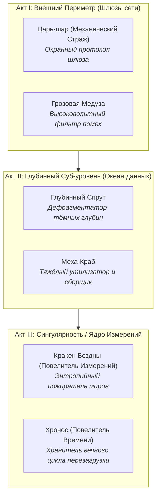

# Концепция лора, секретных зон и синергий SharoBoy

> Документ фиксации идей от 16.10.2026.
> Предназначен для последующего детального обсуждения, выбора приоритетов и пошаговой реализации.

---

## 1. Нарратив и Сеттинг: Протокол «Шаробой»

### 1.1. Базовая концепция мира (Кибернетическая матрица)

- **Игрок (Оператор)**: Невидимый оператор терминала, подключающийся к изолированному ядру глобальной цифровой сети («Подсеть 1080»).
- **Ракетка (Фокусирующий Манипулятор)**: Физико-энергетическая платформа, отражатель и направитель квантового потока. Скины ракетки («Классика Неона», «Киберпанк», «Золотая Аркада», «Ледяной Кристалл», «Ретро 8-Бит») — это различные драйверы и прототипы манипуляторов разных эпох развития сети.
- **Шар (Квантовое Ядро / Сингулярность)**: Сгусток сверхплотной энергии, способный резонировать с цифровой материей и разрушать кристаллизованные структуры.
- **Блоки**: Цифровой мусор, застывшие файрволы, архивные кластеры и охранные узлы сети, мешающие продвижению к Ядру.
- **Кристаллы и Монеты**:
  - _Монеты забега (Энерго-байты)_: нестабильные временные циклы памяти, расходуемые на ходу для локальной модификации манипулятора.
  - _Кристаллы (Мета-код / Квантовые ядра)_: стабильные фрагменты исходного кода системы, не подверженные сбросу сессии (переносят апгрейды и кастомизацию между циклами).

---

## 2. Архитектура Актов и Хранители (Боссы)

Кампания — это погружение сквозь 3 эшелона глубины кибер-сети. Каждый Акт охраняется парой альтернативных автономных охранных систем (ИИ-Хранителей).

### 2.1. Диалоговые реплики / Интро боссов

Перед стартом боя (во время фазы прицеливания или на короткой стильной плашке-телетайпе) босс транслирует сообщение в консоль Оператора:

#### Акт I: Внешний Периметр

- **Царь-шар (Механический Страж)**:
  - _Вход_: «[ПРОТОКОЛ_01]: ОБНАРУЖЕН НЕАВТОРИЗОВАННЫЙ СИГНАЛ. КАЛИБРОВКА ЗАЩИТНЫХ ЭКРАНОВ.»
  - _Поражение_: «[ОШИБКА]: КРИТИЧЕСКИЙ СБОЙ СЕРВОПРИВОДОВ. ШЛЮЗ РАЗБЛОКИРОВАН...»
- **Грозовая Медуза**:
  - _Вход_: «[БИО-МАТРИЦА]: НАПРЯЖЕНИЕ В СЕТИ 100 000 ВОЛЬТ. ВЫ БУДЕТЕ ИСПАРЕНЫ.»
  - _Поражение_: «[СБРОС]: РАЗРЯД ИССЯК... ДУГИ ГАСНУТ...»

#### Акт II: Глубинный Суб-уровень

- **Глубинный Спрут (Осьминог)**:
  - _Вход_: «[ГЛУБИНА]: ВОДЫ ДАННЫХ ПОГЛОТЯТ ТВОЙ ИМПУЛЬС. ЩУПАЛЬЦА СЖИМАЮТ КОЛЬЦО.»
  - _Поражение_: «[УХОД В БЕЗДНУ]: ТЫ ЛИШЬ ВСПЛЕСК В БЕСКОНЕЧНОМ ОКЕАНЕ...»
- **Меха-Краб**:
  - _Вход_: «[УТИЛИЗАТОР]: МЕТАЛЛОЛОМ ОБНАРУЖЕН. КЛЕШНИ НА ВЗВОДЕ, МИНЫ ЗАЛОЖЕНЫ.»
  - _Поражение_: «[СКРЕЖЕТ]: ПАНЦИРЬ РАСКОЛОТ. ПРОТОКОЛ ДЕМОНТАЖА ПРЕРВАН...»

#### Акт III: Финал

- **Кракен Бездны (Повелитель Измерений)**:
  - _Вход_: «[РАЗЛОМ]: ВСЕ ИЗМЕРЕНИЯ СХЛОПЫВАЮТСЯ ЗДЕСЬ. ТВОЙ ШАР НЕ ВЕРНЁТСЯ НАЗАД!»
  - _Победа игрока_: «[ФИНАЛ 1: ОСВОБОЖДЕНИЕ]: РАЗЛОМ ЗАКРЫТ. МАТРИЦА СВОБОДНА ОТ ЭНТРОПИИ.»
- **Повелитель Времени (Хронос)**:
  - _Вход_: «[ТИК-ТАК]: ТЫ ОПОЗДАЛ. КАЖДАЯ СЕКУНДА ЭТОГО БОЯ УЖЕ ПРИНАДЛЕЖИТ МНЕ.»
  - _Победа игрока_: «[ФИНАЛ 2: ПЕРЕЗАГРУЗКА ЦИКЛА]: СТРЕЛКИ ЗАМЕРЛИ. ВРЕМЯ ВЫХОДИТ ИЗ ПЕТЛИ.»

---

## 3. Секретные комнаты и Скрытые порталы (`🌀`)

### 3.1. Как обнаруживаются секреты

1. **Скрытые ветви на карте кампании**:
   - На карте между ярусами появляется полупрозрачный пунктирный узел `🌀` («Скрытый разлом»).
   - Условия проявления:
     - Наличие реликвии «Квантовый сканер» (покупается в магазине или находится в событии «?»).
     - Либо безупречное прохождение смежного испытания-челленджа (без потери жизней).
     - Либо активный мутатор высокой сложности (например, «Железная воля»).
2. **Секретные порталы в бою**:
   - Особый золотистый или фиолетовый блок с трещиной. При уничтожении мячом с серией критов (3 чистых рикошета) на 5 секунд открывается пространственный разлом. Попадание в него мячом мгновенно переносит игрока в Секретную комнату!

### 3.2. Типы секретных комнат

- **«Хранилище Предтеч»**:
  - Нет опасности падения шара (внизу силовое поле).
  - Поле заполнено кристальными блоками, дающими гору очков, монет и несгораемых кристаллов.
- **«Теневой Рынок»**:
  - Встреча с бродячим AI-торговцем, предлагающим экспериментальные запрещённые перки с сильными плюсами и уникальными модификаторами.
- **«Комната Синхронизации»**:
  - Игроку предлагается головоломка с геометрическими отскоками без таймера: попади в 3 переключателя определенным количеством ударов — получи уникальную мета-реликвию.

---

## 4. Дерево синергий и Билдостроение

Сейчас у нас есть:

- 6 постоянных мета-улучшений в профиле;
- 6 мутаторов забега;
- Временные перки и механики ситуативного боя (Гравитационный фокус, Сэйв на грани, Овердрайв серии, Тактическое снабжение).

### 4.1. Концепция целевых архетипов (Билдов)

1. **Архетип «Кинетический Снайпер» (Фокус на угол и криты)**:
   - _Ядро_: Наклон ракетки $\pm30^\circ$ («Маневренный привод») + Овердрайв серии + Сэйвы на грани.
   - _Синергетический эффект_: При серии комбо $\ge 6$ каждый отскок под острым углом оставляет за шаром режущую лазерную линию, наносящую урон соседним блокам.

2. **Архетип «Гравитационный Джаггернаут» (Тяжёлый шар)**:
   - _Ядро_: Мутатор «Гравитационный шторм» + Взрывной/Тяжёлый мяч + Силовое поле ракетки.
   - _Синергетический эффект_: Падающий вниз шар накапливает кинетическую энергию: чем дольше падает, тем выше радиус ударной волны при отскоке от ракетки.

3. **Архетип «Цепной Резонанс» (Мульти-шары и молнии)**:
   - _Ядро_: Раздвоение шара + Грозовая Медуза / Электрические перки + «Комбо-мастер».
   - _Синергетический эффект_: Шары, пролетающие близко друг к другу, образуют между собой электрическую дугу, расщепляющую все блоки между ними.

---

## 5. План пошаговой реализации (на следующие спринты)

| Этап   | Задача                                    | Описание и объём                                                                                                                          |
| :----- | :---------------------------------------- | :---------------------------------------------------------------------------------------------------------------------------------------- |
| **P1** | **Интро-реплики боссов и победный экран** | Добавить стильный компактный баннер/телетайп при входе в бой с боссом (имя, аватар, фраза) и финальный текст при победе в Акте.           |
| **P2** | **Лорные события в узлах «?»**            | Расширить библиотеку текстовых эвентов в `campaignEvents.ts`: «Журналы исследователей», «Терминалы связи», выбор между лорными наградами. |
| **P3** | **Секретные узлы на карте (`🌀`)**        | Реализовать генерацию 1-2 скрытых узлов на кампанию с уникальными условиями доступа и комнатами-бонусами.                                 |
| **P4** | **Синергетические карточки реликвий**     | Ввести систему тегов у перков/магазинов (Кинетика, Электричество, Гравитация, Защита) с активацией комбо-бонусов при сборе пар.           |
